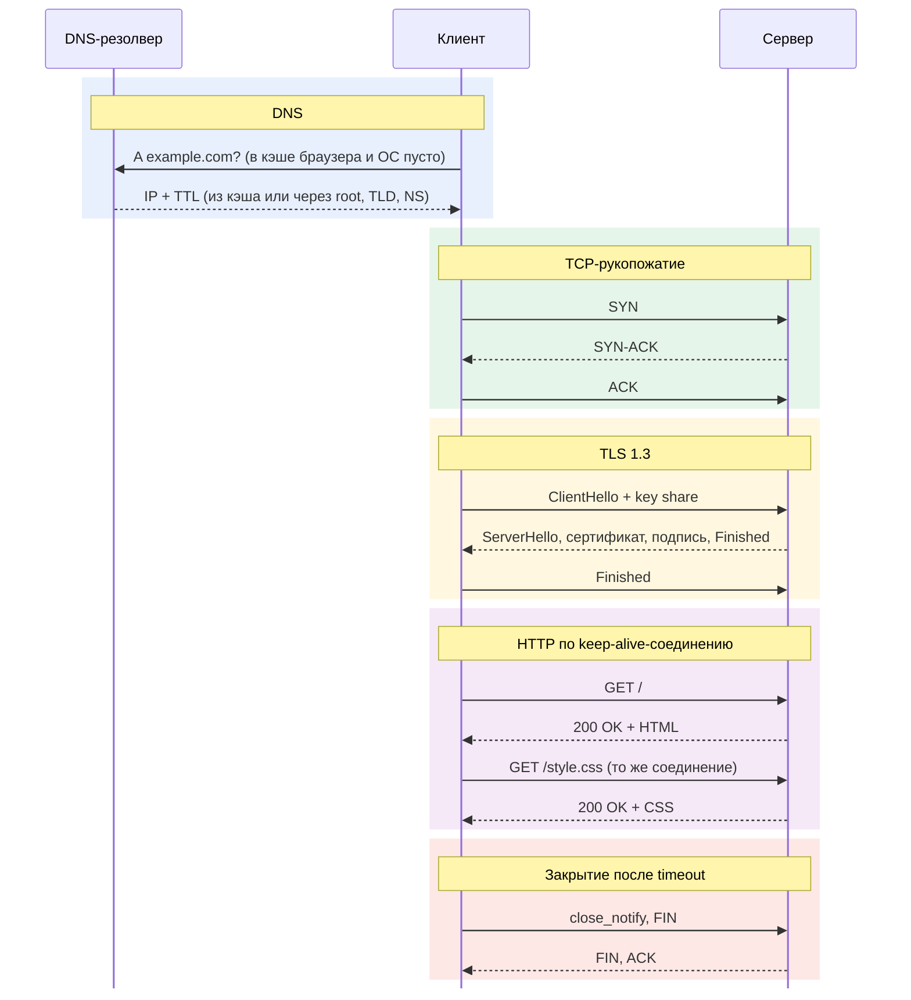

# Путь HTTPS-запроса: от DNS до keep-alive

## Этапы

### 1. Кэш DNS и резолвер

Прежде чем открыть соединение, браузер должен узнать IP-адрес сервера. Сначала он смотрит в собственный DNS-кэш, затем спрашивает stub resolver операционной системы, у которого тоже есть кэш. Если запись найдена и её TTL ещё не истёк, в сеть идти не нужно. Иначе ОС отправляет рекурсивный запрос DNS-резолверу провайдера или публичному резолверу. Тот проверяет свой кэш, а при промахе обходит иерархию итеративными запросами: root-сервер, TLD-сервер, авторитативный сервер домена. Полученную A-запись резолвер кэширует на время TTL и возвращает клиенту.

### 2. TCP-рукопожатие

Зная IP, клиент открывает TCP-соединение, для HTTPS обычно на порт 443. Рукопожатие тройное: клиент шлёт SYN, сервер отвечает SYN-ACK, клиент подтверждает ACK. Так стороны согласуют начальные номера последовательностей, после чего соединение считается установленным. На это уходит один round trip, и до его конца данные приложения не передаются.

### 3. TLS 1.3

Поверх TCP начинается TLS-хендшейк. Клиент отправляет client hello со списком cipher suites и client random и сразу кладёт туда параметры обмена ключами, рассчитывая угадать метод, который выберет сервер. Сервер вычисляет общий секрет и отвечает одной пачкой сообщений: server hello, сертификат, цифровая подпись и Finished. Клиент проверяет сертификат по цепочке до доверенного центра сертификации, проверяет подпись, вычисляет тот же секрет и отправляет свой Finished. Весь хендшейк укладывается в один round trip, а при повторном визите с session ticket клиент может отправить данные уже в первом сообщении (0-RTT). Дальше трафик шифруется симметрично, сеансовыми ключами.

### 4. HTTP-запрос и ответ

Внутри зашифрованного канала браузер отправляет HTTP-запрос, например `GET /` с заголовками Host, User-Agent, Accept и cookies. Сервер обрабатывает его и возвращает строку статуса, заголовки вроде Content-Type, Content-Length и Cache-Control, а затем тело ответа, т.е. HTML-страницу. Браузер разбирает HTML, находит ссылки на CSS, скрипты и картинки и запрашивает их тоже. Если ресурс лежит на другом домене, для него цикл начинается заново с DNS.

### 5. Keep-alive

TCP и TLS 1.3 вместе стоят два round trip ещё до отправки первого запроса, поэтому открывать новое соединение под каждый ресурс дорого. В HTTP/1.1 соединение по умолчанию остаётся открытым (persistent connection, keep-alive), и следующие запросы идут по нему без нового рукопожатия; в HTTP/1.0 для этого нужно было явно передать `Connection: keep-alive`. Сервер ограничивает время простоя и число запросов, что видно в заголовке `Keep-Alive: timeout=5, max=100`. Когда лимит исчерпан или одна из сторон присылает `Connection: close`, соединение закрывается: TLS отправляет close\_notify, а TCP завершается обменом FIN и ACK. HTTP/2 идёт дальше и мультиплексирует много параллельных запросов в одном соединении.

## Sequence-диаграмма

## Замеры через curl

| Сайт | Замер | DNS, мс | TCP, мс | TLS, мс | TTFB, мс | Total, мс |
| --- | --- | --- | --- | --- | --- | --- |
| example.com | 1 | 39,6 | 374,0 | 482,6 | 579,0 | 579,1 |
| example.com | 2 | 2,3 | 278,1 | 388,6 | 483,6 | 483,8 |
| example.com | 3 | 2,1 | 256,9 | 368,5 | 462,1 | 462,3 |
| github.com | 1 | 85,3 | 187,4 | 293,5 | 392,9 | 812,9 |
| github.com | 2 | 2,5 | 44,0 | 90,0 | 132,9 | 375,9 |
| github.com | 3 | 1,7 | 46,2 | 95,9 | 143,3 | 372,7 |

### Почему второй и третий замер DNS быстрее первого

Первый запрос к каждому домену шёл без записи в кэше, поэтому ответ пришлось получать по сети через резолвер. Полученную запись система сохранила в DNS-кэше.

Каждый запуск curl это новый процесс, а собственный DNS-кэш curl живёт только внутри одного процесса. Поэтому второй и третий замер получили ответ из кэша ОС, без запроса в сеть.
